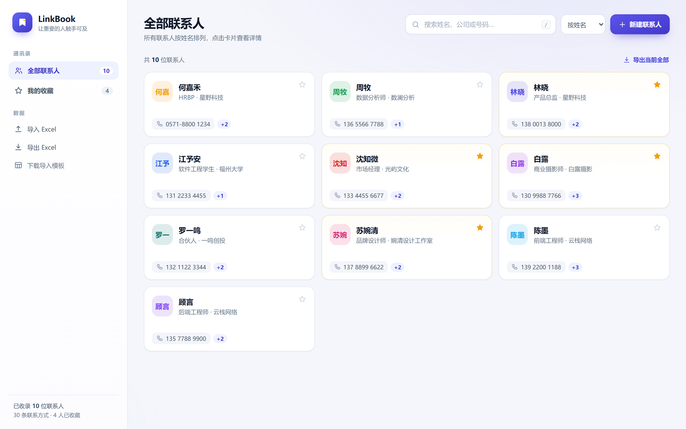

# LinkBook · 可收藏的多方式通讯录

> 软件工程（FZU–MU）极限编程课程作业 —— 一个支持收藏、多联系方式与 Excel 导入导出的通讯录 Web 应用。



## 功能一览

| 功能 | 说明 | 对应评分项 |
| --- | --- | --- |
| 收藏联系人 | 卡片右上角星标一键收藏，侧栏「我的收藏」快速筛选 | Bookmark Contacts（25 分） |
| 多联系方式 | 同一联系人可添加任意多条电话、邮箱、微信、QQ、地址、网站等，支持标签与「主要」标记 | Add Multiple Contact Methods（10 分） |
| Excel 导出 | 一位联系人一行，每种信息独立成列，自动生成不重复的列标题 | Import and Export（25 分） |
| Excel 导入 | 读取同格式 `.xlsx`，逐行校验、跳过缺姓名行、返回导入报告 | Import and Export（25 分） |
| 页面样式 | 响应式布局、抽屉详情、模态编辑、骨架屏、Toast、空状态 | Page Style（10 分） |
| 部署 | Dockerfile + Nginx + systemd 部署脚本 | 云部署（15 分，可选） |

## 技术栈

- **前端**：React 19 + Vite 7，手写 CSS（无 UI 框架）
- **后端**：Node.js 24 + Express 4
- **数据库**：SQLite（Node 内置 `node:sqlite`，无需编译原生模块）
- **Excel**：ExcelJS（读写 `.xlsx`）
- **测试**：Node 内置 `node:test`，13 个接口 / Excel 往返用例

## 快速开始

环境要求：Node.js ≥ 22.5（推荐 24），pnpm 或 npm。

```bash
# 1. 安装依赖
pnpm install --dir server
pnpm install --dir client

# 2. 构建前端
pnpm --dir client build

# 3. 写入示例数据（可选）
node server/src/seed.js

# 4. 启动
node server/src/index.js
# 打开 http://localhost:3000
```

开发模式（Vite 5173 + API 3000，自动代理 `/api`）：

```bash
pnpm --dir server install
pnpm --dir client install
node scripts/dev.mjs
```

运行测试：

```bash
node --test tests/api.test.js
```

## 目录结构

```
linkbook/
├── client/                 React 前端
│   ├── src/
│   │   ├── components/     联系人卡片、详情抽屉、表单、导入弹窗、Toast
│   │   ├── lib/format.js   展示层格式化与常量
│   │   ├── api.js          fetch 封装
│   │   ├── App.jsx         页面状态编排
│   │   └── styles.css      设计系统与响应式样式
│   └── vite.config.js
├── server/
│   └── src/
│       ├── db.js           SQLite 连接与建表
│       ├── contacts.js     联系人 / 联系方式的校验与持久化
│       ├── excel.js        Excel 导入导出（动态列映射）
│       ├── app.js          REST API 与静态资源托管
│       ├── index.js        启动入口
│       └── seed.js         示例数据
├── tests/api.test.js       接口与 Excel 往返测试
├── scripts/                开发、构建、截图、演示录制脚本
├── deploy/                 Nginx 与 systemd 示例
├── docs/                   博客、代码规范、部署文档与图片
├── Dockerfile
└── docker-compose.yml
```

## Excel 格式

导出文件的第一行为表头，列顺序固定：

| 列 | 含义 |
| --- | --- |
| Name / Company / Title / Bookmarked / Notes | 联系人基本信息 |
| Phone 1、Phone 1 Label、Phone 2 … | 第 1、2… 条电话及其标签 |
| Email 1、Email 1 Label … | 邮箱（其余类型同理：WeChat / QQ / Address / Website / Other） |

导入规则：

- 必填列只有 `Name / 姓名`，其余列可缺省；
- 同一类型的多条记录按编号列依次读取，`… Label` 列作为标签；
- 缺少姓名的行会被跳过并在导入结果中列出行号；
- 支持中文表头（姓名、公司、职位、收藏、备注、电话、邮箱、微信……）。

进入应用后点击「下载导入模板」可获得带示例行的文件。

## API

| 方法 | 路径 | 说明 |
| --- | --- | --- |
| GET | `/api/contacts?q=&bookmarked=1&sort=name\|recent` | 列表 / 搜索 / 收藏筛选 |
| GET | `/api/contacts/:id` | 联系人详情 |
| POST | `/api/contacts` | 新建（含 methods 数组） |
| PUT | `/api/contacts/:id` | 更新（methods 全量替换） |
| PATCH | `/api/contacts/:id/bookmark` | 收藏 / 取消收藏 |
| DELETE | `/api/contacts/:id` | 删除（级联删除联系方式） |
| GET | `/api/export` | 导出全部联系人为 `.xlsx` |
| GET | `/api/export/template` | 下载导入模板 |
| POST | `/api/import` | 上传 `.xlsx`（multipart，字段名 `file`） |
| GET | `/api/stats` | 总数 / 收藏数 / 联系方式数 |

## 部署

`docs/DEPLOY.md` 提供云服务器（华为云 / 阿里云）与 Docker 两种部署方式，`deploy/` 内含 Nginx 与 systemd 配置。

## 团队

| 成员 | 主要职责 | 贡献占比 |
| --- | --- | --- |
| 郑子阳 | 后端数据层、Excel 导入导出、表单与整体集成、部署文档 | 55% |
| 郑棕元 | 前端界面与交互、搜索与收藏、测试、演示素材 | 45% |

团队成员：郑子阳、郑棕元。

## License

MIT
