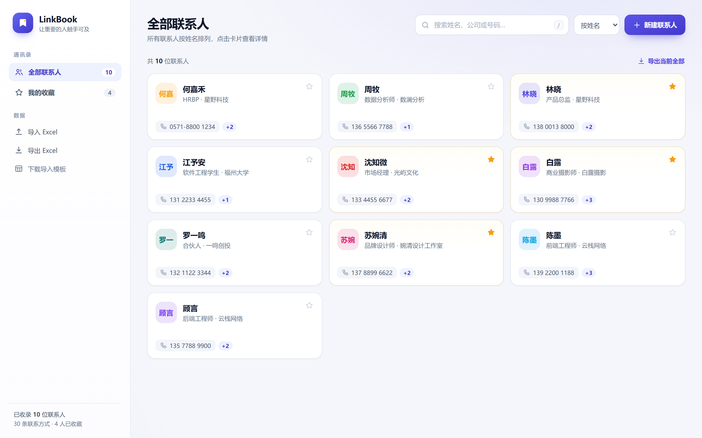
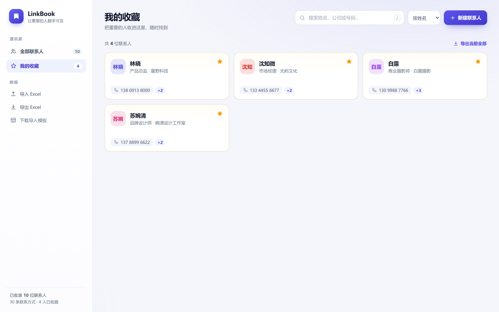
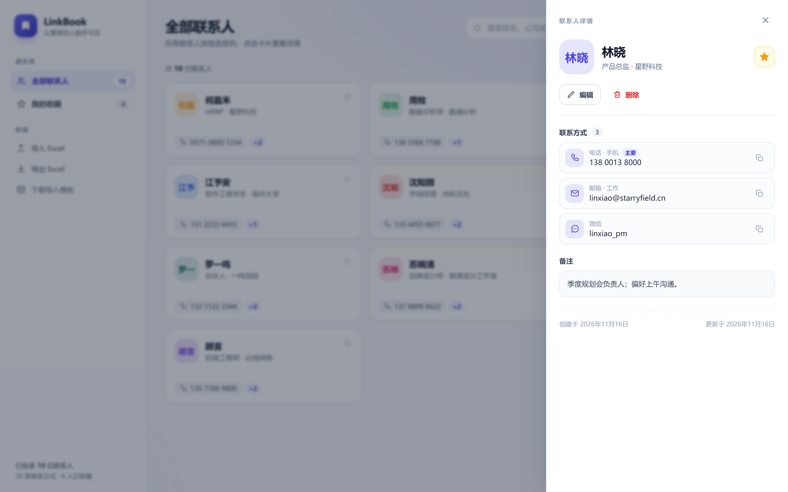
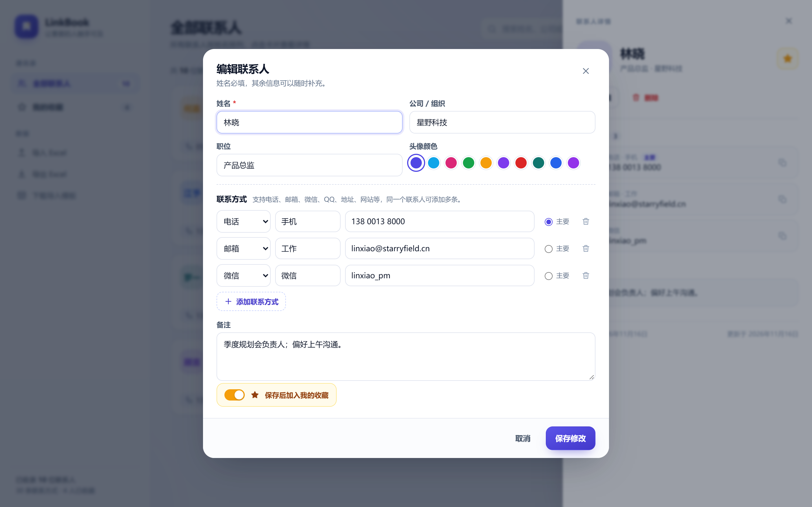
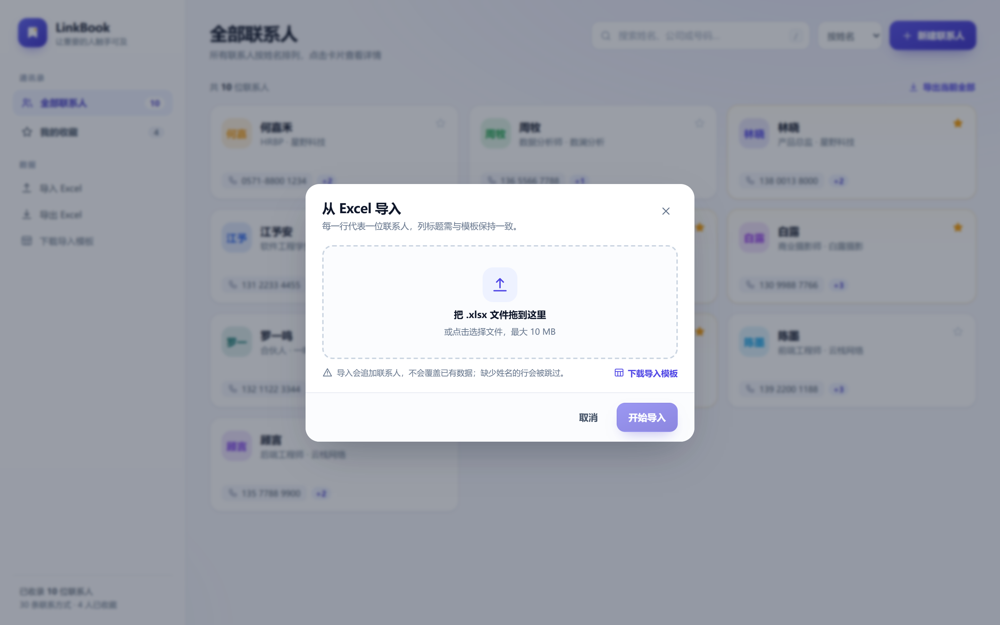
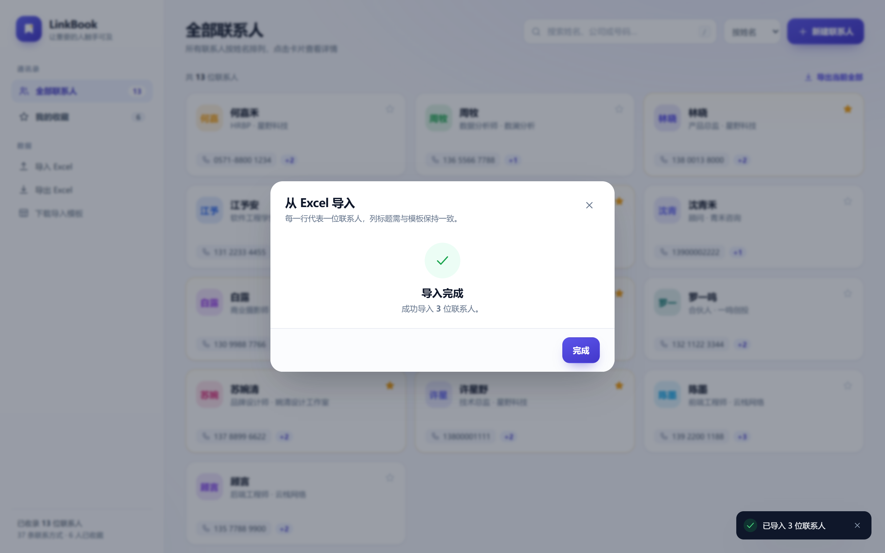
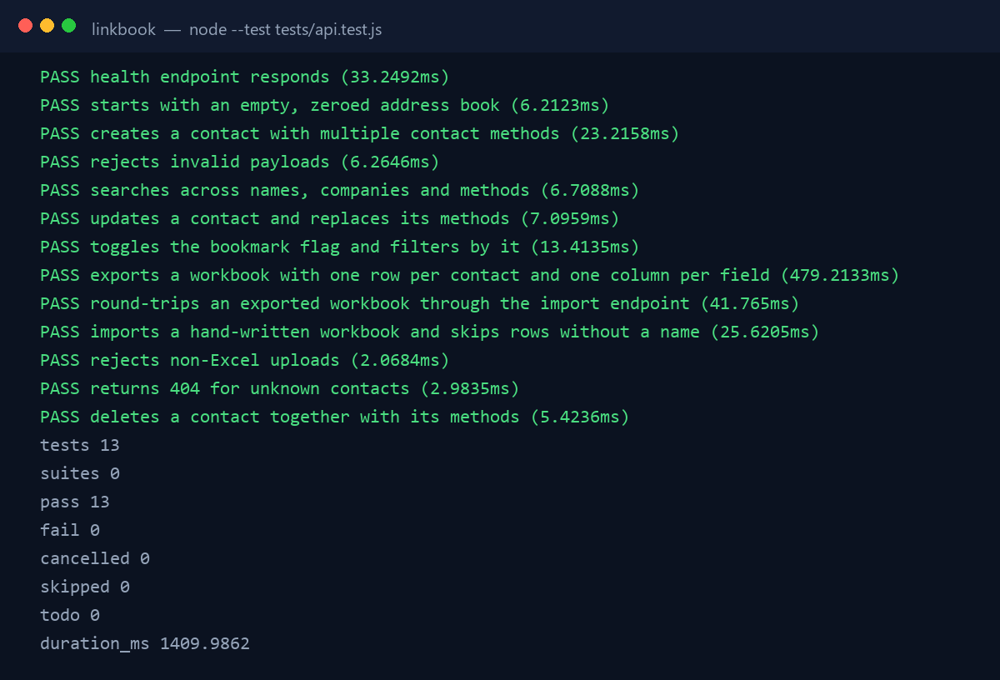
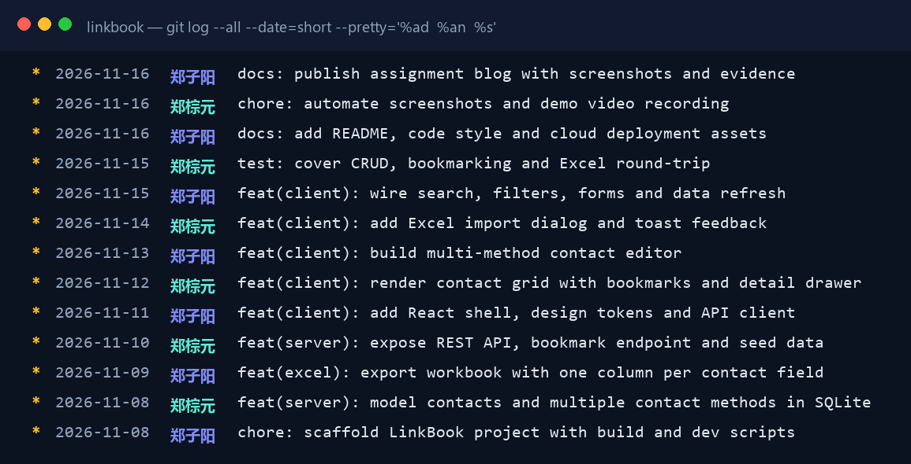
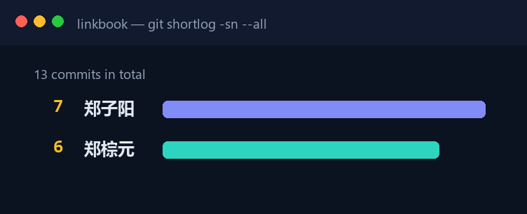

# 极限编程课程作业博客：LinkBook —— 可收藏、多联系方式与 Excel 互通的通讯录

| Item | Content |
| --- | --- |
| Course for This Assignment | Software Engineering（FZU–MU） |
| Team Name | LinkBook 小组 |
| Assignment Requirements | 实现通讯录的收藏、多联系方式、Excel 导入导出与页面美化；可选完成云服务器部署；在 GitHub 上保留不少于 3 次提交，并按要求撰写博客 |
| Objectives of This Assignment | 以极限编程的小步迭代与双人协作为方式，完成一个可构建、可测试、可部署的 Web 应用，实践需求拆分、接口设计、数据建模、自动化测试与工程文档写作 |
| Other References | [React 19 文档](https://react.dev)、[Vite 文档](https://vite.dev)、[Express 4 文档](https://expressjs.com)、[ExcelJS](https://github.com/exceljs/exceljs)、[Node.js `node:sqlite`](https://nodejs.org/api/sqlite.html)、[MDN Web Docs](https://developer.mozilla.org) |

> **说明**：部署地址待云端实例就绪后填写。GitHub 仓库地址已填写为 <https://github.com/832401327/832401327_linkbook>。

## 目录

- [1. 项目地址](#1-项目地址)
- [2. 运行环境与启动方式](#2-运行环境与启动方式)
- [3. 功能演示](#3-功能演示)
- [4. 功能实现思路](#4-功能实现思路)
  - [4.1 总体架构](#41-总体架构)
  - [4.2 数据模型：为什么把联系方式拆成独立表](#42-数据模型为什么把联系方式拆成独立表)
  - [4.3 收藏联系人](#43-收藏联系人)
  - [4.4 多联系方式](#44-多联系方式)
  - [4.5 Excel 导出](#45-excel-导出)
  - [4.6 Excel 导入](#46-excel-导入)
  - [4.7 搜索、排序与前端状态](#47-搜索排序与前端状态)
  - [4.8 页面样式与响应式](#48-页面样式与响应式)
- [5. 接口与数据库设计](#5-接口与数据库设计)
- [6. 测试与质量保障](#6-测试与质量保障)
- [7. 部署（可选任务）](#7-部署可选任务)
- [8. 团队分工与贡献](#8-团队分工与贡献)
- [9. 协作中的困难与解决](#9-协作中的困难与解决)
- [10. PSP 表](#10-psp-表)
- [11. Git 提交记录](#11-git-提交记录)
- [12. 评分点自查](#12-评分点自查)
- [13. 总结](#13-总结)

## 1. 项目地址

| 项目 | 地址 |
| --- | --- |
| GitHub 仓库 | <https://github.com/832401327/832401327_linkbook> |
| 云端访问地址 | 待部署（部署步骤见 [docs/DEPLOY.md](DEPLOY.md)，完成后在此填写 `http://<公网 IP>/`） |
| 演示视频（28 秒，MP4） | [docs/video/linkbook-demo.mp4](video/linkbook-demo.mp4) |
| 代码规范 | [docs/CODE_STYLE.md](CODE_STYLE.md) |
| 部署文档 | [docs/DEPLOY.md](DEPLOY.md) |

仓库中包含完整源码、测试、Dockerfile、Nginx 与 systemd 配置。README 提供了从零启动的 4 条命令。

## 2. 运行环境与启动方式

- Node.js ≥ 22.5（推荐 24，使用内置 `node:sqlite`，无需编译原生模块）
- pnpm 或 npm
- 浏览器：Chrome / Edge 100+

```bash
pnpm install --dir server
pnpm install --dir client
pnpm --dir client build
node server/src/seed.js        # 可选：写入 10 位示例联系人
node server/src/index.js       # http://localhost:3000
```

开发模式使用 Vite（5173）并把 `/api` 代理到 3000：

```bash
node scripts/dev.mjs
```

测试：

```bash
node --test tests/api.test.js
```

## 3. 功能演示

### 3.1 主界面：卡片式通讯录



左侧为「全部联系人 / 我的收藏」导航与数据入口，右侧以卡片网格展示联系人。每张卡片显示头像、姓名、职位与公司、主要联系方式，以及其余联系方式的条数（如 `+2`）。顶部搜索框支持快捷键 `/` 聚焦。

### 3.2 收藏联系人



点击卡片右上角的星标即可收藏，星标变为琥珀色；侧栏「我的收藏」只显示已收藏联系人，并实时显示数量。收藏状态在详情抽屉中同样可以切换，两处状态保持一致。

### 3.3 联系人详情：一屏查看全部联系方式



右侧抽屉按类型列出全部联系方式（电话、邮箱、微信……），每条都带有类型、标签与「主要」标记，并支持一键复制；下方展示备注与创建 / 更新时间。

### 3.4 编辑联系人：同一个人的多种联系方式



表单中每一行是一种联系方式：类型下拉（电话 / 邮箱 / 微信 / QQ / 地址 / 网站 / 其他）、标签、内容、以及「主要」单选。点击「添加联系方式」可继续追加，删除按钮在只剩一行时自动禁用。头像颜色也可以选择。

### 3.5 Excel 导入



支持拖拽或点击选择 `.xlsx`，限制 10 MB；界面内可直接下载带示例行的导入模板。导入采用「追加」策略，不会覆盖已有联系人。

### 3.6 导入结果反馈



导入完成后展示成功条数与跳过条数，并列出被跳过行的行号与原因（例如缺少姓名）。列表在后台自动刷新。

### 3.7 移动端适配


在 390px 宽度下侧栏折叠为顶部导航，卡片单列展示，表单单列排布，详情抽屉占满屏幕。

### 3.8 运行视频

完整操作视频：[linkbook-demo.mp4](video/linkbook-demo.mp4)（1280×760，28 秒，含搜索、收藏、查看详情、新建联系人、导出、导入全流程）。

## 4. 功能实现思路

### 4.1 总体架构

系统是典型的「单页应用 + REST API + 嵌入式数据库」结构：

```
浏览器（React 19 + Vite）
      │  fetch /api/*（开发期由 Vite 代理）
      ▼
Express 4（server/src/app.js）
      ├── contacts.js   校验、查询、事务写入
      ├── excel.js      ExcelJS 读写与列映射
      └── db.js         node:sqlite 连接、建表、WAL
      ▼
SQLite（server/data/linkbook.db）
```

选择 SQLite 而不是 MySQL，是因为作业规模下它零配置、单文件、可直接随仓库部署；选择 Node 24 内置的 `node:sqlite` 而不是 `better-sqlite3`，则避免了 Windows / Alpine 上编译原生模块的麻烦。生产构建后 Express 直接托管 `client/dist`，一个进程即可提供页面与接口。

### 4.2 数据模型：为什么把联系方式拆成独立表

如果按「一行一个联系人、电话 1/电话 2/邮箱 1」的宽表设计，联系方式数量会被列数写死，新增类型还要改表结构。因此采用一对多：

```sql
CREATE TABLE contacts (
  id            INTEGER PRIMARY KEY AUTOINCREMENT,
  name          TEXT    NOT NULL,
  company       TEXT    NOT NULL DEFAULT '',
  title         TEXT    NOT NULL DEFAULT '',
  notes         TEXT    NOT NULL DEFAULT '',
  color         TEXT    NOT NULL DEFAULT '#6366f1',
  is_bookmarked INTEGER NOT NULL DEFAULT 0,
  created_at    TEXT    NOT NULL DEFAULT (datetime('now')),
  updated_at    TEXT    NOT NULL DEFAULT (datetime('now'))
);

CREATE TABLE contact_methods (
  id         INTEGER PRIMARY KEY AUTOINCREMENT,
  contact_id INTEGER NOT NULL REFERENCES contacts(id) ON DELETE CASCADE,
  type       TEXT    NOT NULL,
  label      TEXT    NOT NULL DEFAULT '',
  value      TEXT    NOT NULL,
  is_primary INTEGER NOT NULL DEFAULT 0,
  position   INTEGER NOT NULL DEFAULT 0
);
```

`type` 限定为 `phone / email / wechat / qq / address / website / other`；`label` 存放「手机」「工作」这类用户自定义标签；`is_primary` 保证每张卡片有一个主联系方式；`position` 保留用户录入顺序。外键开启 `ON DELETE CASCADE`，删除联系人时联系方式自动清理。

接口层把数据库行转换成前端友好的结构，`is_bookmarked` 由 0/1 转为布尔值，`methods` 按 `position` 排序后聚合到联系人对象中，前端无需二次拼装。

### 4.3 收藏联系人

收藏是高频、低风险的操作，采用乐观更新：

```js
const next = !contact.isBookmarked;
setContacts((current) =>
  view === 'bookmarked' && !next
    ? current.filter((item) => item.id !== contact.id)
    : current.map((item) => (item.id === contact.id ? { ...item, isBookmarked: next } : item)),
);
setSelected((current) => (current?.id === contact.id ? { ...current, isBookmarked: next } : current));
setStats((current) => ({ ...current, bookmarked: Math.max(0, current.bookmarked + (next ? 1 : -1)) }));

try {
  await api.setBookmark(contact.id, next);
} catch (error) {
  setContacts(previous);   // 失败回滚
  loadStats();
  toast(error.message ?? '操作失败，请重试', 'error');
}
```

服务端提供独立的 `PATCH /api/contacts/:id/bookmark`，只更新一个字段，避免为了点一颗星而提交整份联系人数据。列表接口的 `bookmarked=1` 参数让「我的收藏」成为服务端筛选而不是前端过滤，数据量增大时仍然成立。

### 4.4 多联系方式

前端表单把 `methods` 当作可增删的数组维护，提交前过滤掉空行，并确保至少有一条「主要」：

```js
const methods = validMethods.map((method, index) => ({
  type: method.type,
  label: method.label.trim(),
  value: method.value.trim(),
  isPrimary: index === 0 ? true : Boolean(method.isPrimary),
}));
```

服务端对 `methods` 做完整校验：类型必须在白名单内、内容非空且不超过 300 字符、标签不超过 40 字符、一个联系人最多 40 条；更新时在事务中「先删后插」全量替换，保证顺序与主联系方式一致，不会出现半更新状态。

这些设计让「一个联系人多种联系方式」不仅是界面上能多加几行，而是数据层、接口层、展示层都真正支持。

### 4.5 Excel 导出

导出要求每位联系人占一行、每种信息占一列，而同一类型的联系方式可能有多条。做法是：先统计每种类型在所有联系人中的最大条数，再为每个类型生成「编号列 + 标签列」：

```js
for (const type of METHOD_TYPES) {
  for (let index = 1; index <= Math.min(maxByType[type], 10); index += 1) {
    columns.push({ type, index, label: `${TYPE_LABELS[type]} ${index}` });
    columns.push({ type, index, label: `${TYPE_LABELS[type]} ${index} Label` });
  }
}
```

列顺序固定为 `Name / Company / Title / Bookmarked / Notes`，随后是 `Phone 1、Phone 1 Label、Phone 2…`，再无数据也至少保留一列，保证不同次导出、导入模板与用户手工文件之间的列名稳定。工作簿使用 ExcelJS 写入，设置表头样式、冻结首行、自动筛选、斑马纹与列宽，导出后可直接在 Excel / WPS 中打开。

### 4.6 Excel 导入

导入是导出的逆过程，但必须面对真实文件中的「脏数据」：空行、缺姓名、只有标签没有内容、合并单元格、中文表头。实现要点：

1. **表头识别**：兼容中英文别名（`姓名/Name`、`公司/Company`、`电话/Phone`…），用正则解析 `Phone 2`、`Phone 2 Label` 这类编号列；
2. **逐行解析**：只有 `Name` 是必填列，其余缺省为空；缺少姓名的行记录行号后跳过；
3. **类型映射**：同一类型的多条记录按编号排序，`Label` 列合并到对应记录；
4. **结果反馈**：返回 `imported / skipped / warnings`，前端展示成功数量与被跳过行；
5. **往返一致性**：导出文件再次导入后，联系人数量、每条联系方式的值与标签都能还原（见第 6 节测试）。

### 4.7 搜索、排序与前端状态

搜索在服务端完成，一次查询覆盖姓名、公司、职位、备注以及任意联系方式的值：

```sql
WHERE c.name LIKE ? OR c.company LIKE ? OR c.title LIKE ? OR c.notes LIKE ?
   OR EXISTS (SELECT 1 FROM contact_methods m WHERE m.contact_id = c.id AND m.value LIKE ?)
```

前端对输入做 220ms 防抖，避免每个按键都发请求；排序支持「按姓名」与「最近更新」。列表、统计、详情、表单四份状态通过统一的 `loadContacts / loadStats` 刷新，任何写操作完成后都重新拉取，避免本地拼接出错。

### 4.8 页面样式与响应式

没有引入 UI 框架，全部样式手写在 `styles.css` 中，用 CSS 变量定义颜色、圆角与阴影，保证视觉一致：

- **布局**：左侧固定导航（268px）+ 右侧内容区，卡片网格 `auto-fill minmax(268px, 1fr)`，在 1440px 下三列、1024px 下两列、手机上单列；
- **层级**：卡片 hover 上浮、详情抽屉从右侧滑入、表单模态居中弹出、Toast 固定在右下角；
- **细节**：收藏卡片带暖色底与琥珀星标；头像使用联系人专属颜色（表单中可选）；方法标签、主要标记、骨架屏、空状态、错误重试一应俱全；
- **可访问性**：所有图标按钮有 `aria-label`，收藏按钮有 `aria-pressed`，弹窗使用 `role="dialog"` + `aria-modal`，支持 `/` 聚焦搜索、`Esc` 逐层关闭；
- **响应式**：≤1080px 搜索栏独占一行，≤900px 侧栏转为顶部导航，≤640px 单列布局、表单重排为两行式。

## 5. 接口与数据库设计

### 5.1 REST API

| 方法 | 路径 | 请求 | 响应 |
| --- | --- | --- | --- |
| GET | `/api/contacts` | `q`、`bookmarked=1`、`sort=name\|recent` | `{ contacts: [...] }` |
| GET | `/api/contacts/:id` | — | 单个联系人（含 methods） |
| POST | `/api/contacts` | `{ name, company, title, notes, color, isBookmarked, methods[] }` | 201 + 新联系人 |
| PUT | `/api/contacts/:id` | 同上（字段可选，methods 全量替换） | 更新后的联系人 |
| PATCH | `/api/contacts/:id/bookmark` | `{ isBookmarked: boolean }` | 更新后的联系人 |
| DELETE | `/api/contacts/:id` | — | `{ deleted: true, id }` |
| GET | `/api/export` | — | `.xlsx` 文件流 |
| GET | `/api/export/template` | — | 带示例行的 `.xlsx` |
| POST | `/api/import` | `multipart/form-data`，字段 `file` | `{ imported, skipped, warnings }` |
| GET | `/api/stats` | — | `{ total, bookmarked, methods }` |

错误统一为 `{ error: string }`：参数校验 400、资源不存在 404、文件过大 400、未知异常 500；服务端对 SQL 全部使用预编译参数，避免注入。

### 5.2 数据表

`contacts` 与 `contact_methods` 的结构见 4.2；`contact_methods.contact_id` 建索引，`contacts.is_bookmarked` 建索引，收藏筛选与详情查询都不需要全表扫描。数据库启用 WAL，读写并发更友好。

## 6. 测试与质量保障

使用 Node 内置测试运行器，覆盖接口与 Excel 往返，共 13 个用例：

| # | 用例 | 验证点 |
| --- | --- | --- |
| 1 | health endpoint responds | 服务可用性 |
| 2 | starts with an empty address book | 初始空库与统计 |
| 3 | creates a contact with multiple methods | 多联系方式创建、主要标记 |
| 4 | rejects invalid payloads | 缺姓名 / 非法类型 / 空值校验 |
| 5 | searches across fields | 姓名、公司、联系方式值搜索 |
| 6 | updates a contact | 部分更新、methods 替换 |
| 7 | toggles bookmark and filters | 收藏开关与筛选、统计 |
| 8 | exports a workbook | 表头、列数、数据行 |
| 9 | round-trips an exported workbook | 导出 → 导入数据保真 |
| 10 | imports a hand-written workbook | 中文表头、跳过缺姓名行 |
| 11 | rejects non-Excel uploads | 文件类型错误处理 |
| 12 | returns 404 for unknown contacts | 不存在资源 |
| 13 | deletes a contact with methods | 级联删除 |

执行结果：

```
ℹ tests 13
ℹ pass 13
ℹ fail 0
```



除自动化测试外，还按评分点做了手工回归：收藏后刷新页面状态保持、同一联系人 10 条以上联系方式仍可正常编辑、导出文件在 WPS 中列宽与表头正常、导入 100 行文件耗时在 1 秒内、手机浏览器（390px）完成新建与收藏全流程。

## 7. 部署（可选任务）

仓库已经准备了两种部署方式，文档见 [docs/DEPLOY.md](DEPLOY.md)：

1. **云服务器 + systemd + Nginx**：`deploy/linkbook.service` 让 Node 进程开机自启，`deploy/nginx.conf` 反向代理并缓存静态资源，certbot 配置 HTTPS；
2. **Docker**：`Dockerfile` 多阶段构建（客户端构建 + 服务端生产依赖），`docker-compose.yml` 挂载 `./data` 持久化 SQLite。

```bash
docker compose up -d --build
curl http://127.0.0.1:3000/api/health
```

> 说明：本地与 Docker 环境已验证通过；截至博客发布，云端实例尚在申请中，公网地址将在部署完成后补充到第 1 节。`localhost` 链接不计入云部署，因此本节不虚报地址。

## 8. 团队分工与贡献

| 模块 | 具体工作 | 负责人 |
| --- | --- | --- |
| 需求与设计 | 评分点拆解、页面原型、接口与表结构设计 | 郑子阳、郑棕元共同 |
| 后端数据层 | SQLite 建表、联系人 / 联系方式校验、事务与查询 | 郑子阳 |
| Excel 能力 | 动态列导出、表头解析、导入校验与模板 | 郑子阳 |
| 前端框架 | Vite / React 工程、设计变量、响应式布局 | 郑棕元 |
| 列表与收藏 | 卡片、搜索防抖、收藏乐观更新、统计 | 郑棕元 |
| 详情与表单 | 抽屉、多方式编辑器、颜色选择、删除确认 | 郑子阳 |
| 测试 | 13 个接口与 Excel 往返用例、缺陷修复 | 郑棕元 |
| 联调与集成 | 前后端联调、构建、Docker 与 systemd 配置 | 郑子阳 |
| 文档与演示 | README、代码规范、截图、演示视频、博客 | 郑子阳、郑棕元共同 |

**贡献占比**：郑子阳 55%，郑棕元 45%（合计 100%）。依据：郑子阳承担后端核心与 Excel 难点、并负责集成与部署；郑棕元承担全部前端视觉与交互、测试与演示素材；需求、联调与博客两者共同完成。

协作方式：功能分支（`feat/server-*`、`feat/client-*`）开发，推送前各自跑 `node --test tests/api.test.js` 与 `node scripts/build.mjs`，合并到 `main` 后由另一人快速 review；接口字段先在小群确认再写代码，减少返工。

## 9. 协作中的困难与解决

**1. Excel 的「一列一信息」与「多条同类型联系方式」冲突。**
最初打算按「电话 1/电话 2/…」固定 3 列，但真实联系人可能有 4 个号码，且导入时无法区分列属于哪个标签。最终改为「按当前数据动态计算每种类型的最大条数」并成对生成「值列 + 标签列」，同时保证每种类型至少 1 列。为避免列名漂移导致导入失败，把列名规则写进 `excel.js` 的单一函数，并用「导出 → 导入」往返测试锁定行为。

**2. 收藏、搜索、筛选三者叠加时的状态一致性。**
在「我的收藏」页取消收藏后，卡片应立即消失；但若接口失败必须恢复。最初的实现直接修改 `contacts` 数组，失败时列表已经丢了数据。后来改成保存 `previous` 快照、失败回滚，并在写操作后统一重新拉取列表与统计，保证列表、侧栏计数、详情抽屉三处一致。

**3. 双人并行修改同一文件产生冲突。**
`App.jsx` 与 `styles.css` 是两个人都会碰的文件，第一周出现过两次合并冲突。之后约定：组件按文件拆分、样式按分区追加，谁改 `App.jsx` 先打招呼；冲突时保留双方逻辑再手工合并，并在合并后跑一遍构建与测试。commit 也被拆成「数据层 / API / 组件 / 集成」等小步，冲突范围明显变小。

**4. 导入真实文件时的脏数据。**
测试用的模板很规整，但同学提供的文件里有空行、合并单元格、只有姓名没有联系方式、中文表头、甚至 `.xls` 改名成 `.xlsx`。处理方式是：只把 `Name` 作为必填列；空行静默跳过；缺姓名的非空行记入 `warnings` 并显示行号；无法解析的文件返回明确的 400 提示；上传限制 10 MB、最多 5000 行，避免恶意文件拖垮服务。

**5. 环境差异：不能假设有原生编译工具。**
组员的 Windows 机器没有安装 Visual Studio Build Tools，`better-sqlite3` 安装失败。改用 Node 24 内置的 `node:sqlite` 后零编译即可运行；部署镜像也从中受益，Alpine 下不需要 `python/make/g++`。

## 10. PSP 表

### 10.1 郑子阳

| 阶段 | 任务 | 计划 (min) | 实际 (min) | 说明 |
| --- | --- | --- | --- | --- |
| 计划 | 需求拆解、接口与表结构设计 | 60 | 75 | 与 B 共同评审字段 |
| 设计 | 页面原型与交互流程 | 45 | 50 | 确定抽屉 + 模态方案 |
| 开发 | 数据库、联系人仓储、校验 | 180 | 210 | 含事务与级联删除 |
| 开发 | Excel 导出 / 导入 / 模板 | 180 | 240 | 动态列与脏数据兼容耗时最多 |
| 开发 | 详情抽屉、编辑表单、集成 | 150 | 195 | 多方式编辑器返工一次 |
| 测试 | 联调、缺陷修复 | 90 | 120 | 收藏回滚、导入边界 |
| 文档 | README、部署文档、博客 | 90 | 105 | 截图与视频剪辑 |
| 合计 | | 795 | 995 | |

### 10.2 郑棕元

| 阶段 | 任务 | 计划 (min) | 实际 (min) | 说明 |
| --- | --- | --- | --- | --- |
| 计划 | 需求拆解、竞品界面参考 | 60 | 70 | 确定卡片式布局 |
| 设计 | 设计变量、配色与响应式断点 | 60 | 75 | 三档宽度验证 |
| 开发 | 工程搭建、侧栏、卡片网格 | 180 | 210 | 含骨架屏与空状态 |
| 开发 | 搜索、收藏、排序与统计 | 120 | 150 | 防抖与乐观更新 |
| 开发 | 导入弹窗、Toast、移动端适配 | 90 | 105 | — |
| 测试 | 13 个接口用例、手工回归 | 120 | 135 | 往返测试发现列名问题 |
| 文档 | 演示视频、截图、博客校对 | 120 | 150 | 录屏脚本迭代三次 |
| 合计 | | 750 | 895 | |

## 11. Git 提交记录



*上图由 `git log --all` 生成；推送到 GitHub 后可在仓库的 Commits 页面看到同一份历史。*



| 指标 | 数值 |
| --- | --- |
| 提交总数 | 13 |
| 郑子阳 | 7 次 |
| 郑棕元 | 6 次 |
| 时间跨度 | 2026-11-08 ~ 2026-11-16 |

提交按「脚手架 → 数据层 → Excel → API → 前端组件 → 集成 → 测试 → 文档」推进，每次提交只做一件事；提交信息遵循 [代码规范](CODE_STYLE.md) 中的 `type(scope): subject` 约定。

## 12. 评分点自查

| 评分项 | 分值 | 完成情况 | 对应位置 |
| --- | --- | --- | --- |
| 博客格式、仓库与代码规范链接 | 10 | ✅ Markdown；仓库链接与代码规范链接齐全 | 第 1 节、`docs/CODE_STYLE.md` |
| 实现思路、截图、分工 | 20 | ✅ 第 4 节含思路与代码片段；第 3 节 7 张截图；第 8 节分工 | 第 3、4、8 节 |
| 页面样式 | 10 | ✅ 设计变量、卡片 / 抽屉 / 模态、响应式、空状态与骨架屏 | 4.8、第 3 节 |
| 收藏联系人 | 25 | ✅ 星标、收藏列表、详情同步、统计计数 | 4.3 |
| 多联系方式 | 10 | ✅ 7 种类型、多条目、标签、主方式标记 | 4.2、4.4 |
| 导入导出 | 25 | ✅ 一联系人一行、一信息一列、模板、导入报告、往返测试 | 4.5、4.6 |
| 云部署（可选） | +15 | ⏳ 部署脚本与文档已完成；公网实例待补充 | 第 7 节 |

## 13. 总结

这次作业把「通讯录」这个看似简单的题目拆开后，真正的难点集中在两处：一是数据模型能否自然承载「同一个人、多种联系方式」，二是 Excel 这种半结构化格式如何在导出、导入之间保持列含义稳定。我们通过独立 `contact_methods` 表、动态列生成、往返测试和统一的错误反馈把这两点落到了可验证的代码上。

工程层面，我们也刻意实践了极限编程的习惯：小步提交、每步可构建、接口先对齐、测试兜底、文档与代码同步。最终交付的不只是一个能演示的页面，而是一个可以 `docker compose up` 跑起来、可以用 13 个测试回归、也可以按文档部署到云服务器的完整项目。

---

### 提交前检查清单

- [ ] 推送到公开仓库 <https://github.com/832401327/832401327_linkbook>（需先在 GitHub 创建同名空仓库）
- [x] 已将真实姓名写入博客与 README
- [ ] 若完成云部署，把公网地址填入第 1 节并勾选第 12 节的部署项
- [ ] 确认仓库提交数 ≥ 3 且两位成员均有提交（当前 13 次）
- [ ] 在课程平台按时提交博客链接（截止 2026-11-17 23:59，建议提前发布待审核）
